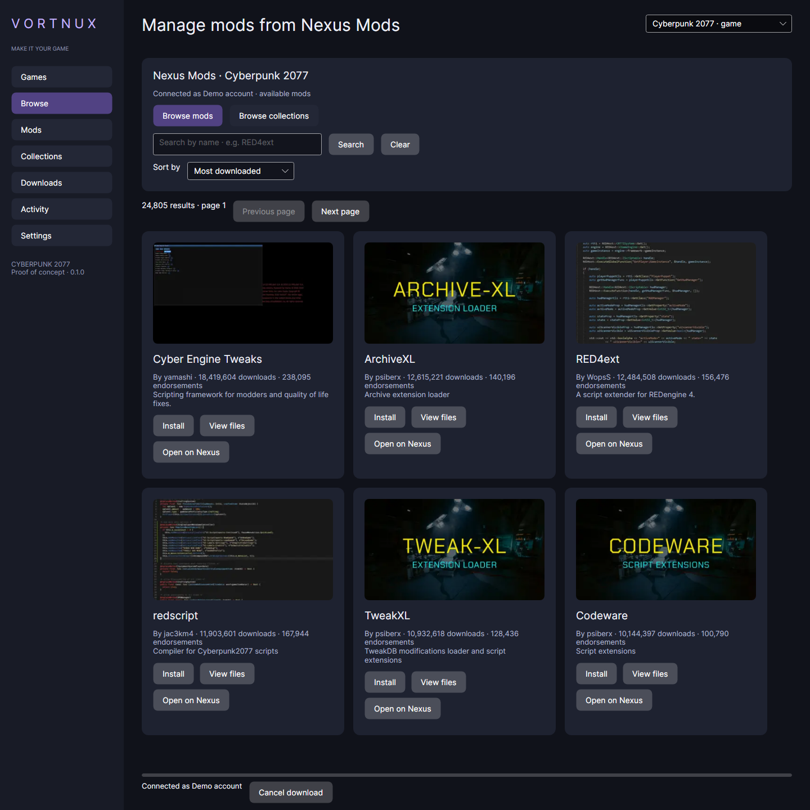

# Vortnux

A Linux-first Cyberpunk 2077 mod manager built with C#, Avalonia 12 and .NET 10 Native AOT. This is a working, bounded proof of concept; it is not yet a replacement for all Vortex game adapters and installers.

## Screenshots

Mods and collections use wrapping cards across rows and columns, with thumbnails, search, sorting and installation actions. The grid reflows as the window resizes.



Rendered application UI with a demo account and public Nexus catalog data. Mod thumbnails belong to their respective authors. [Collection card preview](docs/screenshots/collections-cards.png) uses fixture collection data.

## Run

To run from source, select the desktop project explicitly (requires the SDK pinned in `global.json`):

```sh
dotnet run --project src/Vortnux.Desktop -c Release
```

Bare `dotnet run` at the repository root cannot select a project because the executable project lives under `src/`. Development runs use the .NET runtime; use the published executable or packages below for Native AOT.

Local deliverables are in `dist/`:

```sh
chmod +x dist/Vortnux-0.1.0-x86_64.AppImage
./dist/Vortnux-0.1.0-x86_64.AppImage
# If FUSE is unavailable:
APPIMAGE_EXTRACT_AND_RUN=1 ./dist/Vortnux-0.1.0-x86_64.AppImage

# Arch package; installs the native app and declares its system dependencies:
sudo pacman -U dist/vortnux-0.1.0-1-x86_64.pkg.tar.zst
vortnux
```

No installed .NET runtime is required. The AppImage still uses system glibc, OpenSSL, fontconfig and X11/XWayland libraries. Install `7zip` to read 7z mods and collection bundles. `libnotify` enables optional background desktop notifications. `libsecret` is required for persistent Nexus connections and supplies `secret-tool` for API-key storage in a running, unlocked Secret Service keyring (such as GNOME Keyring or a compatible KWallet setup). The locally built AppImage targets this Arch machine's glibc; the CI build uses Ubuntu 24.04 for a broader compatibility baseline. Older distributions require separate verification.

1. In **Games**, add the actual game directory containing `bin/x64/Cyberpunk2077.exe`.
2. In **Mods**, import ZIP or 7z archives. **Downloads** previews every destination and marks overlaps.
3. Install reviewed files; explicitly allow overlaps if desired. Later-installed mods take precedence.
4. Disable, enable, or uninstall from the library. Uninstall restores the previous mod owner or original file.
5. For Nexus, connect a personal API key in **Settings**. **Browse** opens automatically with Cyberpunk results. Switch between mods and collections, search by name, sort by newest/update/downloads/endorsements, and page through results. Click **Install** on a result: mods ask you to choose **Install this file**, while collections inspect the manifest before offering **Install collection**. Downloads are staged for destination review; **Install reviewed files** deploys them. Starting another installation clears the previous staging preview. **View files** and **View collection** remain available for inspection. You can also paste a mod/collection URL in **Downloads**. API keys are saved only in your Linux keyring and reconnect automatically. See the [credential guide](docs/credentials.md) for setup, local-file migration and retry/forget controls.
6. Click an installation toast or activity to open its exact game and mod/collection. If the item has since been removed, its activity record opens instead.

Close Cyberpunk before deployment. Downloads can continue while it runs. If deployment is interrupted, startup reverts the journal before accepting another operation. External file changes block overwrite/recovery and show the affected path; resolve that change and retry recovery in Settings.

**Mods** and **Collections** list installations managed by Vortnux. Their name filters work locally; Mods also filters enabled/disabled entries. Externally installed mods are not automatically adopted. **Browse** lists available Nexus content, with mod thumbnails, collection cover images and 24 results per page. Images load separately from search and show a fallback if unavailable. Searches are submitted with Enter or Search; sort/type changes refresh immediately. Superseded requests cannot overwrite newer results, and disconnect clears the catalog session. Listing a collection does not establish installer compatibility; manifest checks still run before staging. The catalog uses the official [Nexus GraphQL search API](https://graphql.nexusmods.com/); public mod and collection queries were checked live, while account-specific download acceptance remains pending.

## What this build supports

| Area | Implemented scope |
| --- | --- |
| Game | Manually selected Cyberpunk installations, including Steam/GOG/Proton directories |
| Installers | Plain ZIP/7z layouts under `archive/pc/mod`, `r6/scripts`, `r6/tweaks`, `red4ext`, `bin/x64`; bare `.archive` files map to `archive/pc/mod` |
| Ownership | Content-addressed SHA-256 staging, original backups, deterministic overlap precedence, disable/enable/remove, SQLite deployment journal |
| Nexus | Responsive mod/collection card grid, searchable mod/collection catalog, sorting/pagination, account validation, file listing, exact file download links, authorized free-account nxm links, published GraphQL collection revisions and current v2 archive resolvers |
| Collections | Manifest inspection, pinned Nexus files, required files and optional-file inclusion, download size/MD5 identity checks where provided, batch installation and collection removal |
| Notifications | Persistent history, clickable in-app toasts, exact element selection/highlight/scroll, optional background desktop actions, session gaming mode |
| Releases | Native AOT payload, AppImage, Arch binary package, locked dependency files, CI test and packaging workflow, signed update manifest |
| Updates | Pinned publisher, RSA-PSS/SHA-256 verification, version check, bounded download, native smoke check, database backup, atomic AppImage replacement, startup acknowledgement and recovery journal |

FOMOD choices, REDmod deployment, collection ordering/dependency rules, patches, external/bundled resources, custom installer types and extra installation instructions are rejected before deployment. Dynamic collection file selection is rejected: supported manifests must pin exact file IDs. RAR, named profiles, automatic game discovery, Vortex extension compatibility, resumable downloads, free-account collection orchestration and additional games remain planned work. A supported collection can still contain a mod with an unsupported layout; the entire batch must stage successfully before any game file changes.

Premium is required for automatic collection file downloads. Free accounts can download individual files using Nexus-authorized `nxm://` links; this app does not bypass Nexus download permissions. Browser links can be passed as the executable's first URL argument or pasted into the GUI. It does not yet forward links between running instances or register itself as the default nxm handler automatically. The Arch desktop entry advertises the protocol; selecting a handler remains a desktop setting.

This build has one configuration per game installation. It does not resolve game-version compatibility or launch the game to validate mod behavior. No real account credentials or game content were used in the fixture tests. Live Nexus downloads, a chosen real collection and a Cyberpunk launch remain release-acceptance checks.

## Build and test

Requires .NET SDK 10.0.401, clang and the native Linux dependencies above. Dependency versions and Linux runtime identifiers are locked. UI construction is typed C# rather than runtime XAML/binding discovery; JSON uses source-generated metadata and reflection serialization is disabled.

```sh
dotnet restore Vortnux.slnx --locked-mode -warnaserror
dotnet test Vortnux.slnx -c Release --no-restore -warnaserror
dotnet publish src/Vortnux.Desktop -c Release -r linux-x64 \
  -o artifacts/linux-x64 -p:RestoreLockedMode=true -warnaserror
artifacts/linux-x64/Vortnux.Desktop --smoke-test
bash scripts/package.sh
```

Compiler, linker, AOT and MSBuild warnings fail these commands. No compiler warning suppressions are configured. Packaging pins and checks appimagetool 1.9.1 and the AppImage runtime hashes. The runtime's upstream `continuous` URL can change: a hash mismatch stops packaging and requires an explicit reviewed pin update. Keep the verified tool cache for rebuilding the same snapshot. The local unpublished development build has no homepage URL; Local packaging explicitly defers AppStream catalogue validation because no repository homepage exists; this is the only development packaging exception. CI stamps its real `GITHUB_REPOSITORY` into the AppImage metadata. This metadata limitation does not relax compiler warning policy.

Tests cover file restoration, overlap removal in either order, disabled mods, collection ownership, running-game refusal, interrupted deployment, external edits, corrupt staging, traversal/case/symlink checks, ZIP/7z extraction, manifests, download authorization, source-generated DTOs, signed updates, update failure/recovery, rendered GUI navigation, catalog search/pagination, stale-request rejection, session caching and library filters. The screenshot in `artifacts/screenshots/library.png` uses fixture data. `--smoke-test` exercises SQLite, archive deployment, generated DTOs, catalog JSON metadata and RSA verification in the actual native executable. `--ui-smoke-test` opens the GUI, visits all seven routes and exits; run it in a desktop session or under Xvfb.

State defaults to the .NET local application-data directory plus `vortnux`. Override it with `VORTNUX_STATE_DIR` for isolated fixtures. The original Python scaffold is retained but is not the desktop entry point.

## Generate Nexus clients

The checked-in `api/nexus-v3.openapi.yaml` is the provided [Nexus contract](https://api.nexusmods.com/openapi.yaml), SHA-256 `51218dcafc715a236fbebe884a25d3ac8e517be0aca61fb41345633c9ce628f1`.

```sh
python3 -m pip install -r tools/requirements.txt
python3 tools/generate_nexus.py
```

This emits 114 transport DTOs, source-generated JSON metadata and 38 endpoint methods in `NexusV3Client.g.cs`. Required request members are checked by C#; required wire fields are checked by JSON deserialization. Optional null properties are omitted on write. Wire enums remain strings and anonymous nested JSON remains `JsonElement`; the generator does not implement all OpenAPI constraint validation. It is a repository-owned generator, not Rider or NSwag. CI rejects generation drift. REST v1 and the collection GraphQL read operations are small explicit adapters because they are not defined in this v3 OpenAPI file.

The official [GraphQL API](https://graphql.nexusmods.com/) exposes `collectionRevision`; the v3 REST collection write endpoints do not mean collection reading is unavailable. The manifest adapter follows Nexus's [collection contract](https://github.com/Nexus-Mods/extension-collections/blob/master/src/types/ICollection.ts).

## CI and signed delivery

The [GitHub Actions workflow](.github/workflows/ci.yml) tests, publishes Native AOT, checks the native GUI under Xvfb, packages and tests the AppImage, and builds/installs/removes the Arch package in an Arch container. Pushes and pull requests run the pipeline. Tagged builds create a **draft** GitHub release after those jobs pass. Check [Actions](https://github.com/hicham-bouchikhi/vortnux/actions) for hosted results.


Before tagging a release, configure an RSA publisher key:

- Store the PEM public key in GitHub Actions variable `VORTNUX_RELEASE_PUBLIC_KEY`.
- Store the matching PEM private key in Actions secret `VORTNUX_SIGNING_KEY`; keep the original private key outside this repository.
- Tag a semantic version such as `v0.1.0`. CI embeds the repository/public key, signs the final AppImage manifest, and includes both manifest and signature in the draft release.
- Review the draft and publish it. Only published stable releases are checked by the updater.

The local build intentionally contains an empty trust configuration: it cannot silently trust an arbitrary publisher or unsigned release. AppImage updates retain `<app>.AppImage.previous` and a `before-update-*.sqlite3` backup. On health failure, the old executable and database are restored. A surviving update journal drives next-start recovery. This release has no database migration yet; future migrations require their own compatibility and recovery tests. Keep backups until a release is verified. Arch binaries are updated by pacman; the app refuses to replace them.

## License

Vortnux is licensed under the [MIT License](LICENSE). Third-party dependencies retain their own licenses.

See [the original implementation plan](docs/implementation-plan.md), [the desktop/release plan](docs/desktop-release-plan.md), and [the current implementation status](docs/implementation-status.md).

## Architecture decisions

- [ADR 0001: Store Nexus API keys only in the Linux keyring](docs/adr/0001-nexus-api-key-storage.md)
- [Nexus credential setup and recovery](docs/credentials.md)
- [Current implementation and validation status](docs/implementation-status.md)
